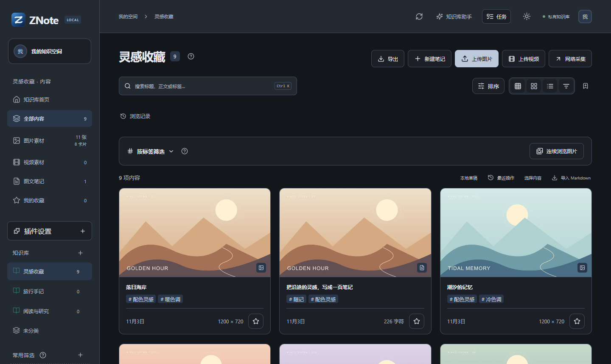
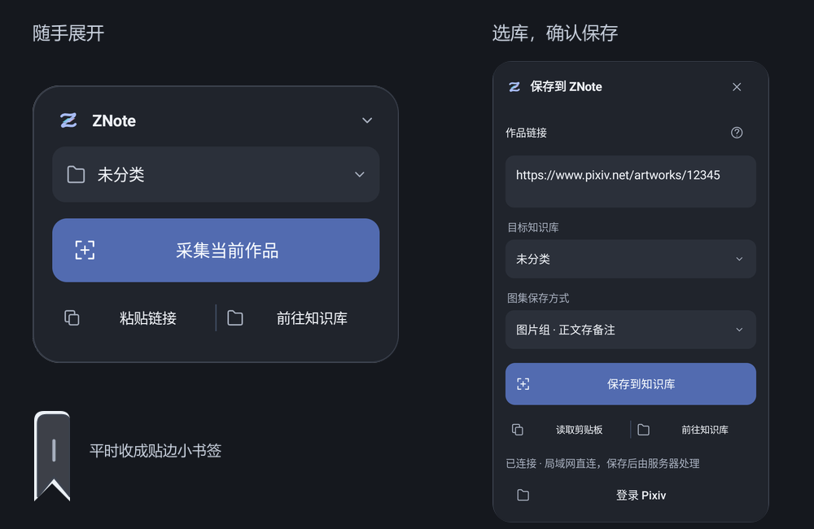
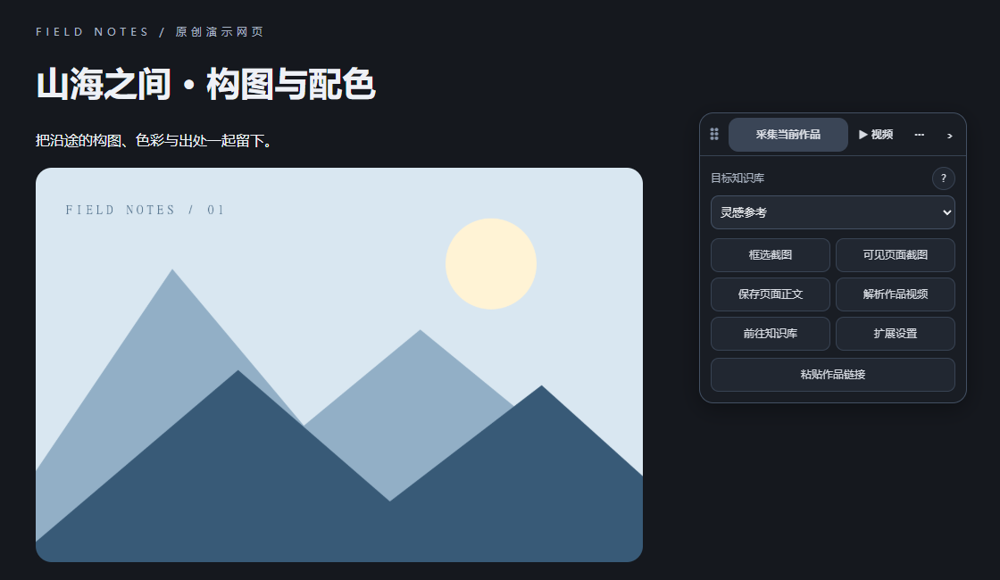

<div align="center">
  
  <h1>ZNote</h1>
  <p><strong>在手机、浏览器和微信里收集，回到同一个知识库整理。</strong></p>
  <p>图片 · 视频 · 成组作品 · 图文笔记 · 正文与来源</p>
  <p><a href="#多端采集">多端采集</a> · <a href="#整理与回看">整理与回看</a> · <a href="#快速开始">开始使用</a> · <a href="docs/README.md">文档</a> · <a href="https://github.com/BorderArea01/ZNote/releases">下载客户端</a></p>
</div>

ZNote 是自托管的多媒体知识库。刷到作品、看到参考图、想到一句话，都可以随手存下，再按项目、知识库和标签整理。文件与数据库保存在自己的电脑或 NAS，手机和电脑连接同一服务，无需重复导入素材。



## 多端采集

### 手机：复制链接，选库保存，继续浏览

开启 Android 的悬浮窗、无障碍采集辅助和 **「复制链接后打开保存面板」** 后，在原 App 点击「复制链接」，ZNote 会弹出保存面板并填入分享内容。选好知识库，确认保存；浮窗收起，服务器在后台处理，完成或失败都会反馈。



平时收成贴边小书签，点击展开，也可拖动换位置。支持采集当前作品、读取剪贴板、直接粘贴链接和前往知识库。

目前适配 **Bilibili、百度贴吧、小红书、YouTube、Pixiv** 等作品分享链接，抖音也有专用解析路径。链接识别和平台资源解析是两步：自动弹窗依赖原 App 提供复制事件；平台登录、验证或资源限制仍可能影响入库。Pixiv 可在手机 ZNote 内登录。未自动弹窗时，可用系统「分享 → ZNote」或浮窗粘贴继续保存。

[手机连接、权限与后台运行 →](docs/CAPTURE.md#android)

### 浏览器：在原网页完成采集

Chrome / Edge 扩展在页面边缘提供可拖动的采集入口，鼠标掠过展开。选择目标知识库后，可以保存当前作品、悬停单图入库、提取正文、框选截图，或预览并保存嗅探到的视频。进度和结果留在当前页面。知识库顶部的「最近下载」可筛选失败记录、一键重试或移除已结束记录。



小红书等图集默认按图片组整理，正文进入备注，来源随内容保留；贴吧按楼主配图顺序归档。视频按可取得的媒体保存，不能用封面代替视频。可在设置中选择默认下载或入库，也可禁用不希望出现采集工具的网站。

[扩展安装与连接 →](addons/browser/clipper/README.md) · [来源适配与采集范围 →](docs/CAPTURE.md#内容与来源)

### 微信：给自己发消息，汇成一篇笔记

绑定微信 ClawBot 收集会话后，发送文字和图片即可收件。默认按天合并，也可发送 **`/新篇 主题名`** 开始新篇，或选择手动分篇。分开发送的说明和配图按顺序追加，后续可以编辑、排序与整理。

手机和 ZNote 主机无需处于同一局域网；主机保持联网、运行服务并开启接收即可。通道是否可用以实际扫码绑定结果为准。

[扫码绑定、高清图片与收件规则 →](addons/connectors/weixin/README.md)

## 整理与回看

| 内容 | 在知识库里做什么 |
| --- | --- |
| 图片与视频 | 独立保存或成组管理，调整页序与封面；用缩略图跳转，记住浏览位置 |
| 图文笔记 | Markdown、任务列表、双向链接、本地配图；草稿续写与历史版本 |
| 批量素材 | 标签组合筛选、多选、移动、默认收藏、合并或拆分分组；删除先进入回收站 |
| 作品配乐 | 保存平台提供的独立音频，或手动添加；图片组翻页时可连续播放 |
| PSD 参考 | 保留分层原文件，查看图层、切换显示并合成预览；原文件不被修改 |

桌面保留翻页、缩放与平移，手机支持长按多选、滑动翻图和双指缩放。知识库、收藏和浏览记录按库区分。支持简约、毛玻璃、赛博朋克、纸感、建筑故障五种外观，以及浅色、夜间和随系统切换；Android 采集浮窗保持独立的深色面板。

[完整操作指南 →](docs/USAGE.md) · [PSD 与客户端说明 →](docs/CLIENTS.md#psd-图片) · [外观素材 →](docs/design/glitch/README.md)

## 快速开始

### 选一个入口

| 设备 | 使用方式 |
| --- | --- |
| Windows / macOS | [下载客户端](https://github.com/BorderArea01/ZNote/releases)，使用内置本机服务或连接已有服务 |
| Android 10+ | 安装签名 APK，连接电脑 / NAS；支持浮窗采集和应用内检查更新 |
| iPhone / iPad | Safari 打开知识库，可添加到主屏幕；当前没有原生 IPA |
| 电脑、平板与其他设备 | 使用浏览器访问自己的 ZNote 服务 |

各端版本与验证范围见 [Release 说明](https://github.com/BorderArea01/ZNote/releases)；客户端连接同一份知识库，当前不提供整库离线同步。[安装与迁移指南 →](docs/CLIENTS.md)

### 从源码启动

需要 **Node.js 24+**：

```bash
git clone https://github.com/BorderArea01/ZNote.git
cd ZNote
npm ci
npm run build
npm start
```

在运行服务的电脑打开 **[http://localhost:3741](http://localhost:3741)**，首次设置访问密码。默认数据在 `data/`，更新代码时请保留；默认端口为 `3741`。

| 连接场景 | 怎么访问 |
| --- | --- |
| 服务所在电脑 | `http://localhost:3741` |
| 同一局域网 | `http://服务器局域网IP:3741`；手机上的 localhost 指手机自己 |
| 在外提交作品链接 | 配置 [Cloudflare 远程收件箱](addons/connectors/cloudflare/README.md)，Android 与主扩展优先使用已授权、可用的局域网连接 |
| 在外浏览完整图库 | 另行配置远程访问；远程收件箱只投递链接，不是完整图库代理 |

采集和收件需要主机保持运行。Cloudflare 备用入口不承接通用图片、截图或大文件上传；这些操作需要直连。平台视频解析与 m3u8 合并需要媒体组件，可运行 `npm run media:setup` 安装。

[Windows 后台运行、Docker / NAS、HTTPS 与更新 →](docs/DEPLOYMENT.md)

## 数据自己保管，也方便带走

入库原文件与 SQLite 数据库在本机保存，相同文件去重。可导出资料包、原图包、Markdown、JSON 或离线网页；部分平台只提供预览图或转码媒体时，会保留实际取得的文件，不冒称原始画质。

- **日常恢复**：同盘快照复用媒体，默认保留一份，额外占用上限 1 GiB；硬链接失败不会退回整库复制。
- **迁移或异盘备份**：按需生成迁移 ZIP 并下载；同盘快照不能防护磁盘损坏。

[存储占用、快照与迁移步骤 →](docs/STORAGE.md)

## 按需扩展

REST API、OpenAPI、读写令牌、Webhook 和增量事件可连接自己的脚本或采集工具。

- **知识库插件**：按库启用，支持热插拔与引用已有素材，普通知识库无需挂载。私人插件集中在被 Git 忽略的 `plugins/` 目录。[本地插件协议 →](docs/LOCAL_PLUGINS.md)
- **AI 对话学习笔记**：可选插件将 AI 对话整理成可复习的 Markdown 图文笔记，再写入指定知识库。[插件与安装 →](addons/ai/znote-conversation-notes/skills/znote-conversation-notes/SKILL.md)
- **浏览器衍生插件**：独立登记和维护，私人源码不随公开仓库分发。[扩展总索引 →](addons/README.md)

[API 接入 →](docs/API.md) · [开发指南 →](docs/DEVELOPMENT.md) · [文档总索引 →](docs/README.md)

---

[反馈问题](https://github.com/BorderArea01/ZNote/issues) · [参与维护](CONTRIBUTING.md) · [更新记录](CHANGELOG.md) · [宣传片与产品介绍](docs/promo/README.md)

React + Vite · Express · SQLite · Sharp · Manifest V3。自有代码采用 [GPL-3.0-or-later](LICENSING.md)，第三方组件保留原许可。[截图来源与制作说明](docs/images/README.md)
